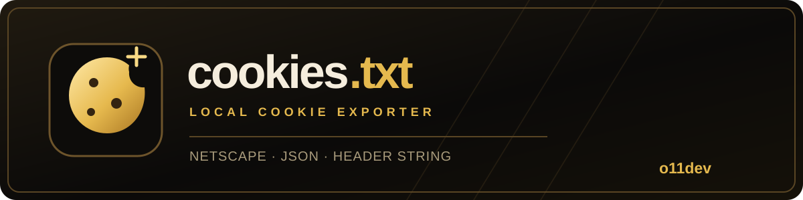
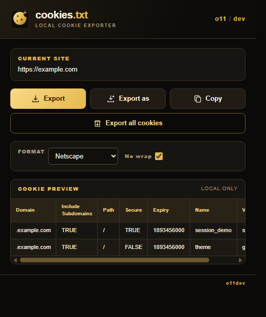

<div align="center">



# cookies.txt

**A local cookie exporter in the o11 black and gold theme.**

Netscape cookies.txt · JSON · Header String

Made by **o11dev**

</div>

## The extension



*Popup preview uses sample data from example.com. No real cookies are shown.*

Export cookies for the current site or all sites, save them as a file, or copy them to the clipboard. The popup shows a preview of the active site's cookies and lets you choose the export format.

Cookie data is handled locally through the browser extension API. This extension does not send it to a server.

## Install

Download the Chrome or Firefox ZIP from [Releases](https://github.com/drmforall/cookies.txt/releases), or build from source below.

### Chrome and Chromium

1. Download and extract the Chrome ZIP from Releases, or clone this repository.
2. Open `chrome://extensions/` and enable **Developer mode**.
3. Select **Load unpacked** and choose the extracted ZIP folder, or the `src` directory if using source.

### Firefox

1. Download the Firefox ZIP from Releases, or run `npm ci` and `npm run build:firefox`.
2. Load the ZIP as a temporary add-on for development, or submit it for signing before regular installation.

## Build and check

```sh
npm ci
npm run check
npm run build
```

Chrome and Firefox ZIP files are written to `dist`. The icon source is `icon-gen/icon.svg`; to regenerate PNGs, run `node run.js` from the `icon-gen` directory.

## Permissions

| Permission | Purpose |
| --- | --- |
| `activeTab` | Identify the current site. |
| `cookies` and host access | Read cookies for the preview and export. |
| `downloads` | Save exports locally. |

## License and attribution

Based on [Get cookies.txt LOCALLY](https://github.com/kairi003/Get-cookies.txt-LOCALLY), licensed under MIT. Its required copyright notice is retained in [LICENSE](LICENSE).
